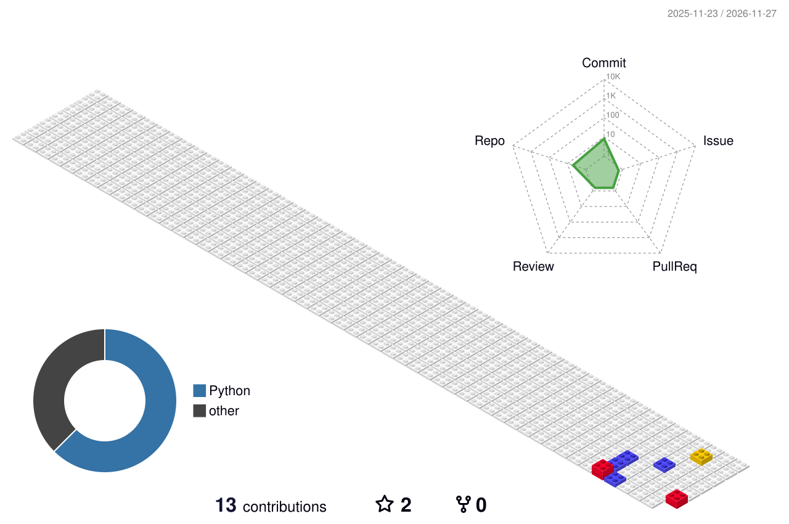

# 你好，我是橘子 👋

专注 Python 数据采集、数据清洗与数据存储，爬虫
后端开发(Django,Flask,Fastapi),docker,redis.....。
正在学习 LangChain、LangGraph 与 AI Agent 开发。

<picture>
  <source media="(prefers-color-scheme: dark)" srcset="https://raw.githubusercontent.com/xiaoju888/xiaoju888/main/dist/github-snake-dark.svg">
  <source media="(prefers-color-scheme: light)" srcset="https://raw.githubusercontent.com/xiaoju888/xiaoju888/main/dist/github-snake.svg">
  
</picture>

